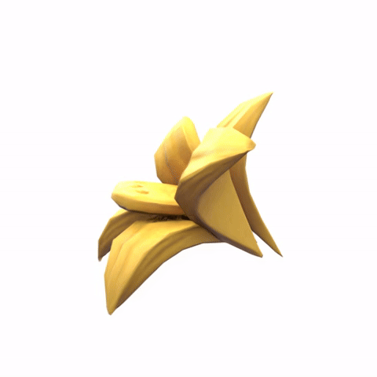
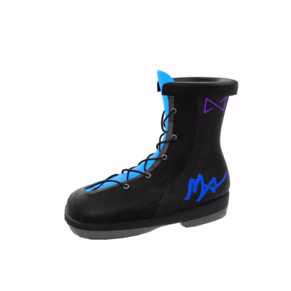
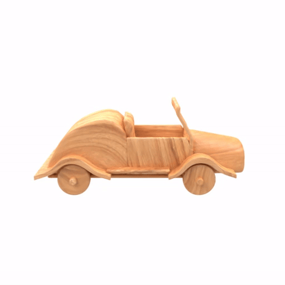
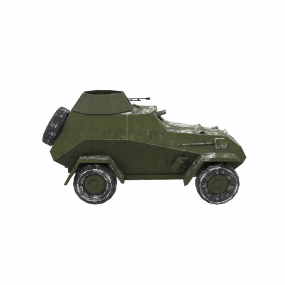
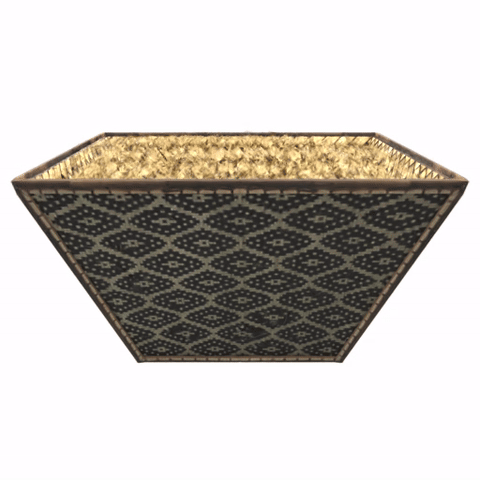
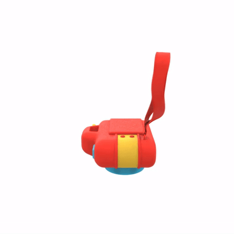
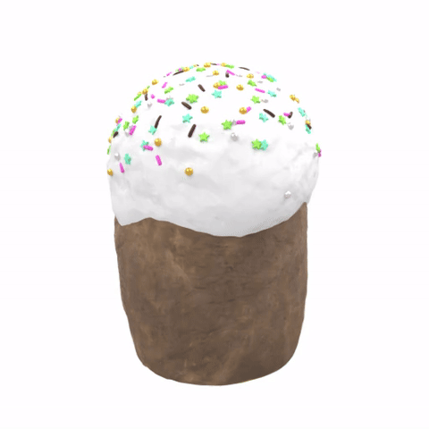
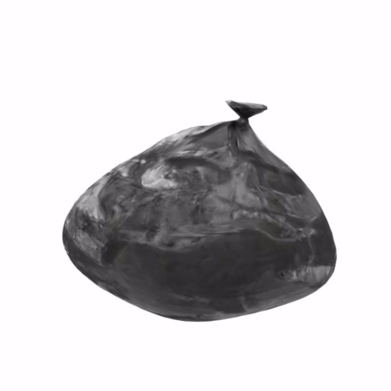
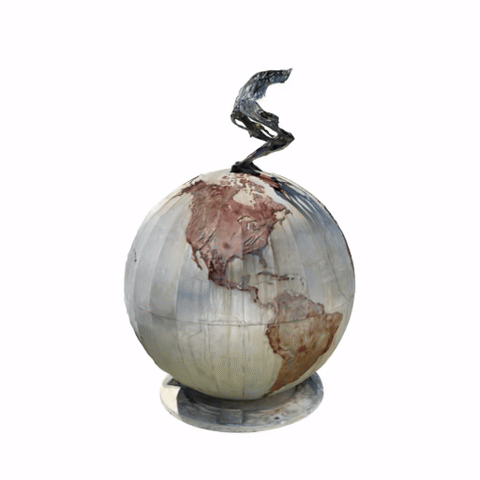
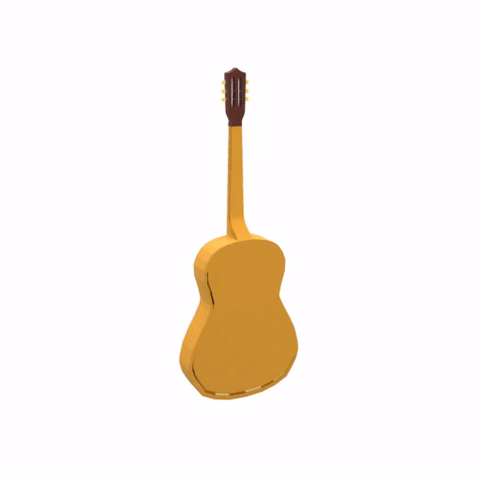

# Objaverse 3D Reconstruction Assignment 2

This repository implements multi-view capture, verified image matching, camera estimation, 3D Gaussian Splatting, evaluation and GIF export for ten objects retained by Assignment 1. Training and image capture run in the user's SenseCore account. The shared Objaverse directory is read-only.

## Current status

All ten known-camera 3DGS reconstructions, their animations, and held-out evaluations are complete. There are also twelve controlled runs and one complete COLMAP-camera Cake pilot. COLMAP meets the predefined 80% registration gate on 4/10 objects; the primary animations must not be described as ten successful image-only camera recoveries. Mean primary foreground PSNR is 30.585 dB. See the [report](assignment2_report.pdf), [findings](docs/experimental_findings.md), and [results table](results.csv).

Data access is verified by `artifacts/afs_probe.json`. The selected UIDs and Assignment 1 cleaning rows are recorded in `configs/objects.json`. The five group members and their contributions are recorded in `configs/team.json` and the report. The group number is 2.

## Ten reconstructed objects

Each GIF is rendered from a trained 3DGS model using known synthetic cameras. Each linked directory includes all verified matching arrays, pair counts, eight matching plots, metrics, and evaluation images. Download the repository and open `index.html` for the offline gallery.

| Flower-chair | Boot | Toy car | Armored car | Flower Vase / basket |
|---|---|---|---|---|
|  |  |  |  |  |
| [Matching results](results/e1b3760e310d4a759cde3146edf40212/matches) | [Matching results](results/8c1e9eaacd48441f9b356cd2d6c0ba63/matches) | [Matching results](results/b5ba3da3c0514d938728c2773cb836d2/matches) | [Matching results](results/2fa42781568549c0861769cbf51d88fc/matches) | [Matching results](results/873be92fc3a54d65bac955231029589b/matches) |

| Camera | Cake | Garbage Bag | Globe sculpture | Guitar |
|---|---|---|---|---|
|  |  |  |  |  |
| [Matching results](results/2891f204385c429eb8ab3cbc28bdf36a/matches) | [Matching results](results/5fb6e07b6d864a4385c0018ed5f88010/matches) | [Matching results](results/e0e9fb929170400c87c03c49a50ce315/matches) | [Matching results](results/e843fbcdd9f746e2bca65e54f02a1845/matches) | [Matching results](results/b3cb7a8487774fc28fa9702f8e36bb9d/matches) |

## Environment

The tested target is Ubuntu 24.04 with Python 3.12, NVIDIA PyTorch 25.06, CUDA 12.9 and one RTX 5090 with 32 GB VRAM. The installation script creates a separate virtual environment and preserves the image's existing PyTorch. Run from this repository inside the container:

```bash
bash scripts/setup_sensecore.sh
source scripts/environment.sh
python scripts/probe_afs.py
python scripts/capture_all.py
python scripts/analyze_sfm.py
python scripts/run_batch.py --jobs 3 --pose-mode known
```

`scripts/setup_sensecore.sh` installs system packages and Nerfstudio 1.1.5. The virtual environment lives on the container's local disk at `/opt/assignment2-venv`, reached through `.venv`, to avoid AFS overhead for Python packages. Recreate it with the setup script if the container filesystem is reset. Code, data provenance and experiment outputs remain in AFS. `artifacts/environment_freeze.txt` records the resolved versions after installation.

## Camera protocols

The default pipeline estimates poses and triangulates a sparse point cloud with COLMAP, then trains Nerfstudio Splatfacto. It rejects registration below 80 percent or missing sparse points. COLMAP's database, all verified feature correspondences and representative matching plots are retained.

For a controlled synthetic-data experiment, use `--pose-mode known`. This uses the calibration from image generation and initializes Gaussians randomly, without loading source mesh geometry into training. It still computes actual SIFT matches and geometric verification. Report these results as **known-pose reconstruction**. They do not demonstrate successful camera estimation from images.

```bash
python scripts/pipeline.py --pose-mode known --variant baseline --resume
python scripts/pipeline.py --pose-mode known --variant fixed_resolution --only UID1 UID2 UID3
python scripts/pipeline.py --pose-mode known --variant few_views --only UID1 UID2 UID3
python scripts/pipeline.py --pose-mode known --variant low_resolution --only UID1 UID2 UID3
python scripts/pipeline.py --pose-mode known --variant short_training --only UID1 UID2 UID3
```

Known-pose experiments use 12 common evaluation views across all variants; evaluation pixels are excluded from optimization and Gaussian initialization. In COLMAP experiments, evaluation images are excluded from the image loss but participate in camera and colored sparse-point estimation, so they can affect initialization. Those metrics are transductive diagnostics. The two protocols must be reported separately.

The main baseline retains Splatfacto's progressive 128-to-256-to-512 resolution schedule. Controlled ablations use `fixed_resolution` as their reference and disable progressive downscaling. This prevents the 3,000-step comparison from also changing the effective image resolution. The three ablation objects are frozen in `configs/ablations.json`.

## Outputs

Each object and experiment directory contains `matches/pairs.csv`, all verified correspondences in NPZ format, matching plots, explicit train/evaluation splits, `metrics.json`, training logs, an MP4 rendered from the trained 3DGS, and `reconstruction.gif`. Direct Blender renders are inputs, not reconstruction GIFs. Failed commands are recorded in `result.json` and the batch continues to the remaining objects. Resume skips completed runs; an unfinished directory must be inspected before restarting in a fresh work directory.

After inspecting a failure in evaluation or export, `scripts/postprocess_run.py --run RUN_DIRECTORY` resumes from a successfully trained checkpoint. It preserves earlier logs and does not retrain the model. The environment script enables the checkpoint-loading format expected by Nerfstudio 1.1.5 with PyTorch 2.8; use it only with checkpoints generated by this project.

Large source GLBs, training checkpoints and raw image folders are excluded from Git. The submission exporter includes the ten GIFs, complete matching results, metrics, logs and source provenance, while keeping training checkpoints in AFS.

Verified correspondences, image IDs and keypoint coordinates are provided as portable NPZ/JSON/CSV files. Full COLMAP descriptor databases and TensorBoard event files remain in the AFS run folders; command logs and measured metrics are included in the portable bundle. Experiments that use identical images reference the shared matching files instead of duplicating them.

```bash
python scripts/build_analysis.py
python scripts/export_submission.py --pose-mode known
python -m pip install -r requirements-report.txt
python scripts/build_report.py
# Visually inspect the PDF, then copy it into submission/assignment2_report.pdf.
python scripts/finalize_bundle.py
```

The report uses the official ICLR 2027 LaTeX style in named-author mode, with the conference publication header replaced by the coursework title. The first page lists the five authors, and the Individual Contributions section contains their responsibilities. Group number 2 and the GitHub URL are typeset as ordinary text. The public repository is https://github.com/wzw26919/assignment2-3d-reconstruction. Course-platform submission remains with the group.

The paper source is in `docs/latex/`. Build the ICLR report from the repository root with `python scripts/build_iclr_report.py --tectonic /path/to/tectonic`, or compile `docs/latex/report.tex` with a standard LaTeX distribution. The original ReportLab builder remains available as an alternative report layout.

## Tests

```bash
python -m unittest discover -s tests -v
```

The tests exercise mount fallback, malformed GLB rejection, COLMAP pair-ID direction and verified-match export, and disjoint/common evaluation views. Full validation additionally requires training on the GPU and visually inspecting every reconstructed object.

## Sources

- [Nerfstudio Splatfacto](https://docs.nerf.studio/nerfology/methods/splat.html)
- [Nerfstudio 1.1.5 source](https://github.com/nerfstudio-project/nerfstudio/tree/v1.1.5)
- [COLMAP documentation](https://colmap.github.io/)
- [3D Gaussian Splatting paper and code](https://repo-sam.inria.fr/fungraph/3d-gaussian-splatting/)

Original object author and license metadata should accompany exported images. `configs/objects.json` preserves the source UID and Assignment 1 license field; do not imply that these assets were authored by the group.
